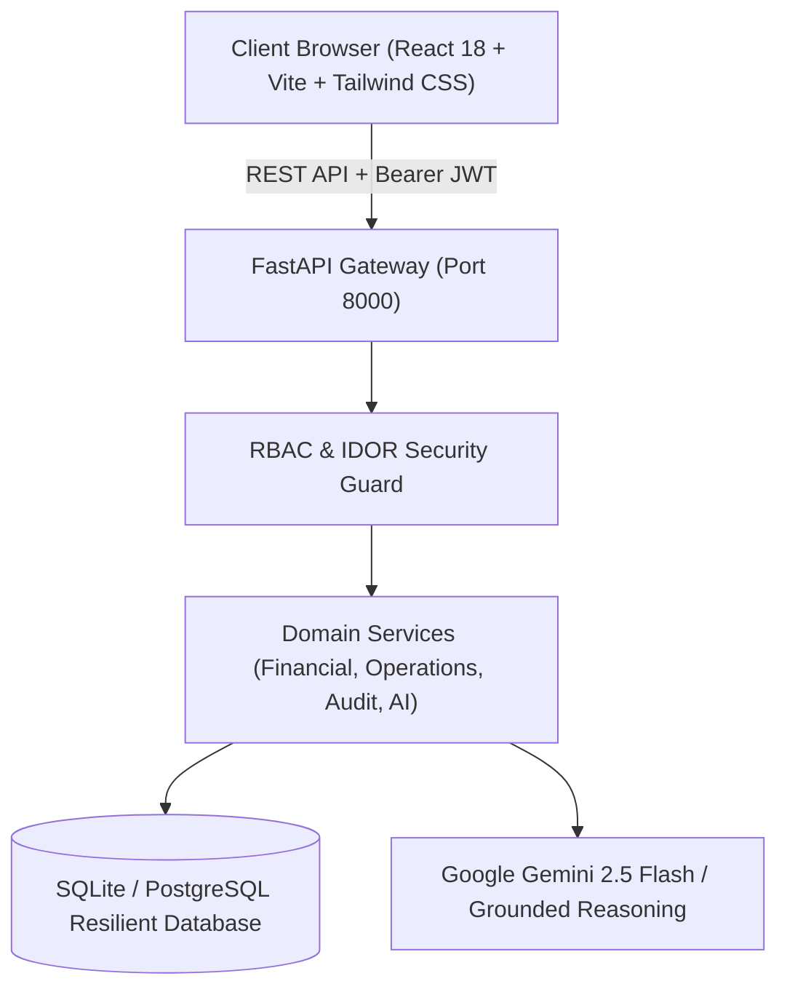

# The Royal Knot
### Production-Grade Luxury Indian Wedding Planning, Marketplace & Operations Management Platform

> **“Every detail connected. Every moment managed. Every wedding unforgettable.”**

[](https://github.com/the-royal-knot/the-royal-knot/actions/workflows/ci.yml)
[](https://fastapi.tiangolo.com)
[](https://react.dev)
[](https://www.typescriptlang.org)
[](https://www.python.org)
[](https://tailwindcss.com)

---

## 1. Overview & Vision

**The Royal Knot** is an enterprise-grade digital wedding agency, curated luxury marketplace, and real-time operations command platform engineered specifically for high-stakes Indian destination weddings across Rajasthan's palace circuit (Jaipur, Udaipur, Jodhpur).

It bridges the gap between regal grandeur and software engineering depth:
1. **Premium Multi-Role Ecosystem:** 4 tailored, authenticated portals for Couples, Wedding Planners, Vendors, and Platform Administrators.
2. **Context-Aware AI Wedding Concierge:** Real-time conversational intelligence grounded directly in the live celebration database, powered by Google Gemini LLM with controlled tools and deterministic fallback.
3. **Dynamic Budget Guardian:** Decimal-safe financial accounting, instant +60 extra guest impact modeling, and a strict state-machine approval workflow preventing unauthorized budget mutations.
4. **Wedding-Day Operations Command Centre:** Minute-by-minute run of show, dynamic schedule impact and transit delay calculation, ripple conflict detection, and authorized revision publishing.
5. **Vendor Marketplace & Double-Booking Prevention:** Multi-factor catering scoring with configurable weights, and transactional availability checks preventing duplicate booking of exclusive vendor slots.
6. **Visual Seating Planner:** Drag-and-drop banquet seating with table capacity validation, VIP dignitaries placement, and single-table allocation enforcement.
7. **Simulated Escrow Milestones:** Staged contract releases with duplicate settlement guards and an immutable platform audit trail.

---

## 2. Technical Architecture & Engineering Depth

Detailed architectural documentation is organized in [`docs/`](file:///c:/Users/haasi/OneDrive/Desktop/the-royal-knot/docs):
- [**System Architecture & Multi-Role Ecosystem**](file:///c:/Users/haasi/OneDrive/Desktop/the-royal-knot/docs/architecture.md)
- [**Relational Database Schema & ER Diagrams**](file:///c:/Users/haasi/OneDrive/Desktop/the-royal-knot/docs/database-schema.md)
- [**AI Concierge Design & Tool Grounding**](file:///c:/Users/haasi/OneDrive/Desktop/the-royal-knot/docs/ai-design.md)
- [**Security, RBAC, IDOR & Escrow Governance**](file:///c:/Users/haasi/OneDrive/Desktop/the-royal-knot/docs/security.md)

### Architectural Highlights



---

## 3. Demo Personas & Authenticated Roles

The platform provides pre-seeded demo personas for each authenticated role:

| Persona | Role | Email | Password | Primary Experience |
| :--- | :--- | :--- | :--- | :--- |
| **Couple** | `couple` | `couple@theroyalknot.com` | `password123` | Rambagh Palace 400-guest portal, Guest Impact Simulator, Seating Planner, Staged Payments. |
| **Lead Planner** | `planner` | `planner@theroyalknot.com` | `password123` | Operational task matrix, Budget Change Request approvals/rejections, Run-of-show publishing. |
| **Vendor** | `vendor` | `vendor@theroyalknot.com` | `password123` | Royal Mewar Catering portal, Quotation tracking, Compliance document upload, Slot availability. |
| **Administrator** | `admin` | `admin@theroyalknot.com` | `password123` | Platform analytics, Vendor verification queue, DPDP privacy requests, Immutable audit log viewer. |

---

## 4. Technology Stack

### Frontend
- **Framework:** React 18 + TypeScript + Vite
- **Styling:** Luxury Indian wedding design tokens (Ivory `#FAF7F2`, Champagne Gold `#C5A059`, Burgundy `#800020`, Charcoal `#2C2A29`) via Tailwind CSS
- **Icons & Visuals:** Lucide React, Leaflet maps, Canvas Confetti
- **State & Routing:** React Router v6, AuthContext with fast demo persona switcher

### Backend
- **Framework:** Python FastAPI (REST API on port 8000)
- **Database ORM:** SQLAlchemy 2.0 (SQLite local zero-config, PostgreSQL staging ready)
- **Financial Calculation:** Decimal-safe `Decimal` arithmetic with `ROUND_HALF_UP`
- **AI Integration:** Google Gemini (`gemini-2.5-flash`) via `google-genai` SDK with live DB context grounding and deterministic fallback
- **Authentication & Security:** JWT (HMAC-SHA256) + Passlib / Bcrypt password hashing
- **Testing:** Pytest with 17 comprehensive test suites covering RBAC, IDOR, Financial, Operations, and AI

---

## 5. Local Setup & Running Instructions

### Prerequisites
- Python 3.10+ (Tested on Python 3.11 / 3.14)
- Node.js 18+ (Tested on Node.js 20 / 24)

### 1. Backend Setup
```bash
# In your terminal, navigate to the project directory:
cd backend

# Install Python requirements
pip install -r requirements.txt

# Seed the database with Jaipur 400-guest celebration scenario
python seed.py

# Launch FastAPI backend server (Port 8000)
python -m uvicorn backend.app.main:app --reload --port 8000
```
- API Gateway: `http://127.0.0.1:8000`
- Interactive OpenAPI Swagger Docs: `http://127.0.0.1:8000/docs`
- Health Endpoint: `http://127.0.0.1:8000/api/health`

### 2. Frontend Setup
```bash
# In a separate terminal, navigate to the frontend directory:
cd frontend

# Install Node dependencies
npm install

# Start Vite development server (Port 5173)
npm run dev
```
- Web Application URL: `http://localhost:5173`

---

## 6. Running the Test Suite & Quality Verification

```bash
# Run all backend unit and production engineering tests:
python -m pytest backend/tests/ -v

# Run frontend TypeScript typecheck and production build:
cd frontend
npm run build
```

---

## 7. Continuous Integration (CI)

A full CI workflow is active at [`.github/workflows/ci.yml`](file:///c:/Users/haasi/OneDrive/Desktop/the-royal-knot/.github/workflows/ci.yml) validating:
1. Automated backend setup, dependency caching, and SQLite seeding.
2. Execution of the complete Pytest suite (RBAC, IDOR, Financial, Operations, AI).
3. Frontend TypeScript compilation and Vite production asset bundling.

---

## 8. License

Developed for hackathon evaluation and production demonstration. All proprietary luxury wedding workflows, brand assets, and designs belong to The Royal Knot.
