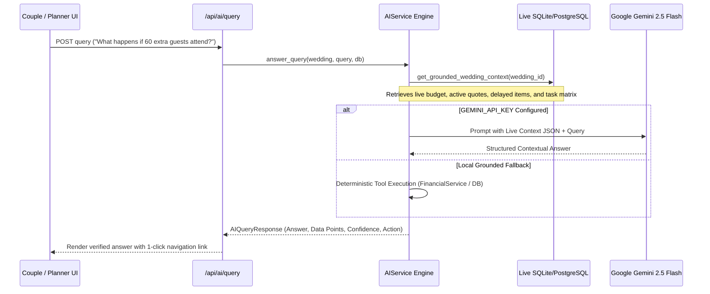

# AI Wedding Concierge Design & Orchestration — The Royal Knot

The AI Wedding Concierge is a context-aware operational intelligence assistant embedded within The Royal Knot. Rather than behaving as an ungrounded general-purpose chatbot, it functions as an authoritative celebration co-pilot with direct access to live financial records, timeline dependencies, vendor commitments, and Indian statutory marriage requirements.

---

## 1. Grounded Context Architecture

---

## 2. Controlled Tools & Grounded Operations

The AI engine executes discrete computational tools grounded in live database rows:

| Tool | Trigger Intent | Data Sources | Output |
| :--- | :--- | :--- | :--- |
| **`get_wedding_financials`** | Payments, escrow, spent, remaining budget | `BudgetCategory`, `PaymentRecord` | Total approved, committed, spent, next milestone due date, escrow balance. |
| **`simulate_guest_impact`** | Adding extra guests (+60 guests, headcount increase) | `FinancialService`, active catering quote | Itemized cost impact: Catering + 18% GST + Seating + Royal Favors. |
| **`get_schedule_status`** | Late vendors, arrival delays, timeline check | `ScheduleItem`, `Incident` | Active delays, impacted downstream ceremonies, mitigation proposals. |
| **`compare_vendor_quotes`** | Catering comparison, best value quote | `Quotation`, `Vendor` | Recommended quotation, price-per-plate, live counters, waitstaff ratio. |
| **`get_legal_marriage_guidance`** | Special Marriage Act, registration, court | Statutory Indian laws (SMA 1954) | 30-day notice, witness requirements (3 adults with ID), required affidavits. |

---

## 3. Governance Boundaries (Section 5.9 Rule)

The AI assistant adheres to strict safety boundaries:
1. **No Autonomous Budget Mutation:** The AI can calculate and explain the financial impact of adding guests, but it will never autonomously approve budget change requests.
2. **No Autonomous Escrow Payouts:** Contract milestones and escrow releases require explicit user authorization.
3. **Transparent Fact Citations:** Answers explicitly reflect live numbers from the celebration database without fabricating dates or currencies.
