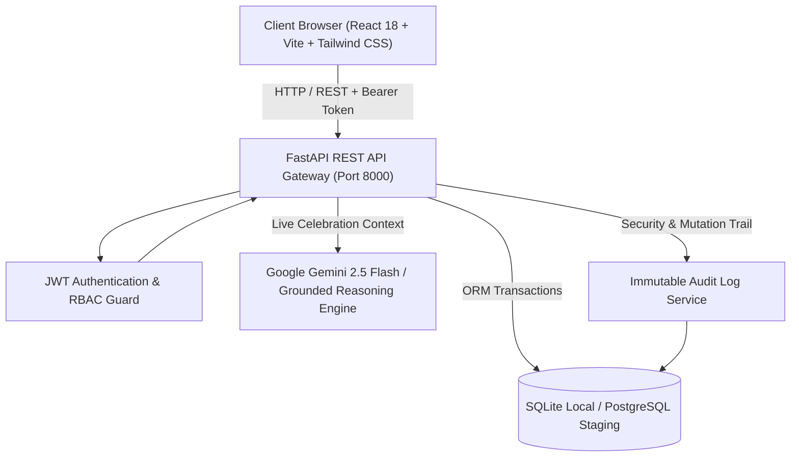

# System Architecture — The Royal Knot

The Royal Knot is an enterprise-grade multi-role Indian wedding management and planning ecosystem built to coordinate high-stakes luxury celebrations across Rajasthan's palace circuits (Jaipur, Udaipur, Jodhpur).

---

## 1. High-Level Architecture

---

## 2. Multi-Role Ecosystem & Boundaries

The platform provides discrete capabilities and tailored interfaces for 4 authenticated user personas:

| Persona | Role Identifier | Authorized Domains | Primary Capabilities |
| :--- | :--- | :--- | :--- |
| **Couple** | `couple` | Owned Wedding celebration | Onboarding, Venue discovery, Guest management, RSVP tracking, Guest Impact Simulation, Staged Payment approvals. |
| **Wedding Planner** | `planner` | Assigned / Demo Celebrations | Task matrix management, Run-of-show orchestration, Budget Change Request approvals/rejections, On-site delay authorizations. |
| **Vendor** | `vendor` | Vendor Profile & Quotes | Commercial quotation submission, Staged milestone tracking, Verification compliance document uploads, Slot availability. |
| **Platform Administrator** | `admin` | Universal platform scope | Vendor compliance verification, Risk & complaint resolution, DPDP privacy request processing, Immutable audit log inspection. |

---

## 3. Core Engine Subsystems

### 3.1 Budget Guardian & Financial Service (`backend/app/services/financial.py`)
- **Decimal Safety:** All currency additions, plate multiplications, and 18% GST computations use `Decimal` with `ROUND_HALF_UP` to prevent IEEE 754 floating-point drift.
- **Formal State Machine:** Scope changes (e.g. adding 60 guests) do not immediately alter the wedding budget. A `pending` `BudgetChangeRequest` is created. Only upon authorized sign-off by a wedding planner or administrator does the official budget update.

### 3.2 Dynamic Wedding-Day Operations Engine (`backend/app/routers/operations.py`)
- **Dynamic Ripple Calculation:** Replaces static mocks with runtime time parsing (`10:00 AM`, `06:30 PM`) and cascading shift evaluation.
- **Buffer & Conflict Analysis:** If vendor setup is delayed, the engine computes downstream impacts on ceremonies in the same venue area, determines if existing buffer absorbs the delay, and generates a proposed run-of-show revision.
- **Planner Sign-off:** Changes do not auto-publish; the planner reviews the mitigation plan and formally executes `/publish-revised-schedule`.

### 3.3 Vendor Intelligence & Double-Booking Guard (`backend/app/routers/quotations.py`)
- **Multi-Factor Scoring:** Evaluates catering quotations across price-per-plate, menu variety (live counters, tableware), and vendor ratings with configurable weights.
- **Double-Booking Prevention:** Validates whether a vendor has an existing accepted contract on the exact wedding date for another celebration before accepting a quotation.

### 3.4 Context-Aware AI Wedding Concierge (`backend/app/services/ai_service.py`)
- **Database Context Grounding:** Directly queries the live database for budget status, overdue payments, delayed items, guest attendance, and task assignments.
- **LLM Provider:** Integrates with Google Gemini (`gemini-2.5-flash`) via the `google-genai` SDK when `GEMINI_API_KEY` is provided.
- **Deterministic Fallback:** When API keys are not supplied, executes verified tool logic against the database to return truthful, mathematically accurate facts with zero hallucination.
