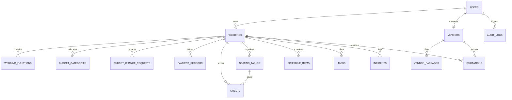

# Database Schema & Entity Relationships — The Royal Knot

The Royal Knot relational schema is modeled using SQLAlchemy ORM and supports SQLite for rapid local testing and PostgreSQL for production deployments.

---

## Entity Relationship Overview

---

## Core Tables & Schema Details

### 1. `users`
- `id` (String, PK, UUID): Unique user identifier.
- `email` (String, Unique): Normalized login email.
- `hashed_password` (String): Securely hashed bcrypt password.
- `full_name` (String): Display name.
- `role` (String): `couple`, `planner`, `vendor`, `admin`.
- `created_at` (DateTime): Registration timestamp.

### 2. `weddings`
- `id` (String, PK, UUID): Wedding celebration identifier.
- `owner_id` (String, FK `users.id`): Couple user who created the celebration.
- `planner_id` (String, FK `users.id`, Nullable): Assigned lead wedding planner.
- `couple_names` (String): e.g. "Aarav Singhania & Meera Kapoor".
- `wedding_date` (String): Target wedding date (`YYYY-MM-DD`).
- `destination_city` (String): `Jaipur`, `Udaipur`, `Jodhpur`.
- `estimated_guests` (Integer): Total invited count.
- `total_budget` (Float): Approved official budget in INR.
- `status` (String): `planning`, `in_progress`, `completed`, `archived`.
- `is_demo` (Boolean): Flag allowing sandbox exploration.

### 3. `budget_change_requests`
- `id` (String, PK, UUID): Change request identifier.
- `wedding_id` (String, FK `weddings.id`): Associated wedding celebration.
- `requested_by_id` (String): User initiating the request.
- `previous_budget` (Float): Official budget prior to proposed adjustment.
- `new_budget` (Float): Proposed new total budget.
- `additional_guests` (Integer): Incremental guest count requested.
- `estimated_cost_impact` (Float): Calculated cost addition (Catering + GST + Seating + Favors).
- `reason` (Text): Justification submitted by couple/planner.
- `status` (String): `pending`, `approved`, `rejected`.
- `approved_by_id` (String, Nullable): Planner or administrator executing sign-off.
- `approval_notes` (Text, Nullable): Review notes.
- `created_at` (DateTime): Timestamp of submission.

### 4. `schedule_items`
- `id` (String, PK, UUID): Schedule milestone identifier.
- `wedding_id` (String, FK `weddings.id`): Associated celebration.
- `title` (String): Ceremony or logistical event name.
- `start_time` (String): Start time (e.g., `10:00 AM`, `06:30 PM`).
- `end_time` (String): End time.
- `venue_area` (String): Hall, garden, or courtyard location.
- `vendor_name` (String, Nullable): Responsible vendor partner.
- `status` (String): `scheduled`, `in_progress`, `delayed`, `completed`.
- `delay_minutes` (Integer): Active recorded delay.
- `dependent_items_json` (JSON): IDs/names of ceremony steps linked to this milestone.

### 5. `audit_logs`
- `id` (String, PK, UUID): Audit entry ID.
- `user_id` (String, Nullable): User initiating the mutation.
- `action` (String): e.g. `BUDGET_CHANGE_APPROVED`, `SIMULATED_PAYMENT_SETTLED`.
- `entity_name` (String): e.g. `BudgetChangeRequest`, `PaymentRecord`.
- `entity_id` (String): ID of affected record.
- `details_json` (JSON): Immutable snapshot of mutation metadata.
- `created_at` (DateTime): Timestamp recorded in UTC.
